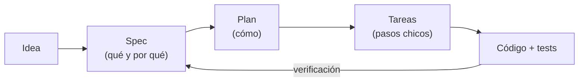

# 1. ¿Qué es Spec-Driven Design?

**Spec-Driven Design (SDD)** o *Spec-Driven Development* es una forma de trabajar
en la que **la especificación es la fuente de verdad** del software. Antes de
escribir código se escribe (y se acuerda) un documento que describe *qué* tiene
que hacer el sistema y *cómo se va a comprobar* que lo hace. El código y los
tests se derivan de ese documento, y no al revés.

## La idea central

La flecha de vuelta es lo importante: siempre se puede comprobar si el código
cumple la spec, porque cada criterio de aceptación tiene un ID y cada test dice
qué criterio cubre (en este repo: `npm run trace`).

## ¿Qué problema resuelve?

| Sin spec                                                   | Con spec                                                         |
| ---------------------------------------------------------- | ---------------------------------------------------------------- |
| Los requisitos viven en la cabeza de alguien o en un chat. | Viven en un archivo versionado junto al código.                  |
| Los casos borde se descubren en producción.                | Se descubren al escribir la spec, cuando alguien pregunta "¿y si…?". |
| "¿Esto está terminado?" es opinable.                       | Está terminado cuando todos los AC tienen tests en verde.        |
| Revisar un PR es leer código y adivinar la intención.      | Se revisa el PR contra la spec.                                  |
| Un agente de IA inventa lo que falta.                      | Un agente de IA tiene contexto preciso y límites claros.         |

## SDD y la IA

SDD se volvió especialmente popular con los asistentes de código (Cursor,
Copilot, Claude, etc.). Un prompt como *"agregá recuperación de contraseña"* deja cientos
de decisiones sin tomar, y el modelo las toma por vos. Una spec las toma de
antemano. Herramientas como [GitHub Spec Kit](https://github.com/github/spec-kit)
o [Kiro](https://kiro.dev) formalizan este mismo flujo: `spec → plan → tasks → implement`.

Este repo implementa el mismo flujo con un harness propio, chico y sin
dependencias, para que se vea cada pieza y se pueda adaptar a cualquier proyecto.

## Relación con otras prácticas

- **TDD**: SDD decide *qué* testear (los AC); TDD es una forma de implementar cada tarea (test rojo → verde → refactor). Se complementan.
- **BDD**: los AC con formato *Dado / Cuando / Entonces* vienen de BDD. SDD los usa pero agrega plan, tareas y trazabilidad.
- **Design docs / RFCs**: parecidos, pero una spec SDD es más chica, más verificable y vive al lado del código.

## Lo que SDD **no** es

- No es escribir 40 páginas antes de empezar. Una buena spec entra en una pantalla o dos.
- No es cascada: la spec cambia, pero **cambia primero la spec** y después el código.
- No reemplaza hablar con la gente; la spec es el resultado de esa conversación.

Siguiente: [2. El flujo paso a paso](02-flujo.md)