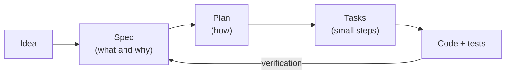

# 1. What is Spec-Driven Design?

**Spec-Driven Design (SDD)** or *Spec-Driven Development* is a way of working
in which **the specification is the source of truth** for the software. Before
writing code you write (and agree on) a document that describes *what* the
system has to do and *how you will check* that it does it. The code and the
tests are derived from that document, not the other way around.

## The core idea

The return arrow is the important part: you can always check whether the code
satisfies the spec, because each acceptance criterion has an ID and each test
says which criterion it covers (in this repo: `npm run trace`).

## What problem does it solve?

| Without a spec                                              | With a spec                                                         |
| ----------------------------------------------------------- | ------------------------------------------------------------------- |
| Requirements live in someone's head or in a chat.           | They live in a versioned file next to the code.                     |
| Edge cases are discovered in production.                    | They are discovered while writing the spec, when someone asks "what if…?". |
| "Is this done?" is a matter of opinion.                     | It is done when every AC has green tests.                           |
| Reviewing a PR is reading code and guessing intent.         | The PR is reviewed against the spec.                                |
| An AI agent invents whatever is missing.                    | An AI agent has precise context and clear limits.                   |

## SDD and AI

SDD became especially popular with coding assistants (Cursor, Copilot, Claude,
etc.). A prompt like *"add password recovery"* leaves hundreds of decisions
unmade, and the model makes them for you. A spec makes them in advance.
Tools such as [GitHub Spec Kit](https://github.com/github/spec-kit)
or [Kiro](https://kiro.dev) formalize this same flow: `spec → plan → tasks → implement`.

This repo implements the same flow with its own small, dependency-free harness,
so every piece is visible and it can be adapted to any project.

## Relationship with other practices

- **TDD**: SDD decides *what* to test (the ACs); TDD is a way to implement each task (red → green → refactor). They complement each other.
- **BDD**: ACs in *Given / When / Then* format come from BDD. SDD uses them but adds plan, tasks, and traceability.
- **Design docs / RFCs**: similar, but an SDD spec is smaller, more verifiable, and lives next to the code.

## What SDD **is not**

- It is not writing 40 pages before you start. A good spec fits in one or two screens.
- It is not waterfall: the spec changes, but **the spec changes first** and then the code.
- It does not replace talking to people; the spec is the result of that conversation.

Next: [2. The flow, step by step](02-flow.md)
