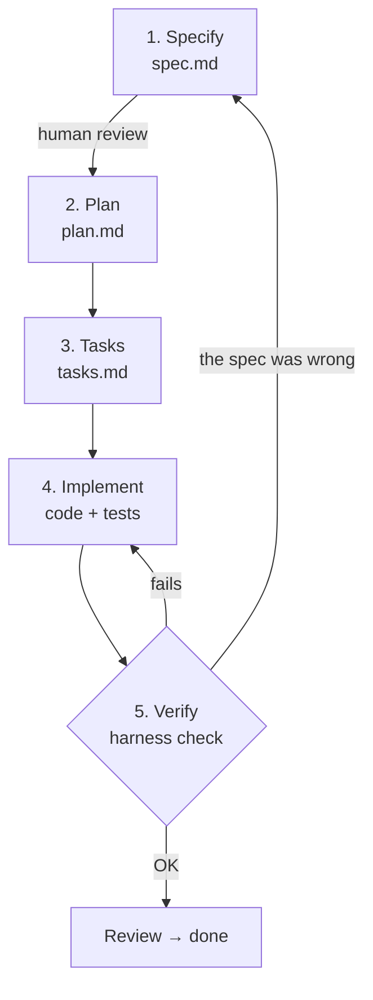

# 2. The flow, step by step

Each phase produces a file inside `specs/NNN-name/`, and each file is
reviewed before moving to the next.



## Phase 1 — Specify (`spec.md`)

**Question it answers:** what needs to be built, and how do we know it is right?

It contains: the original idea, problem, goals, **non-goals**, glossary,
business rules, contract (API/UI/CLI), and **acceptance criteria with IDs**.

It does not contain: class names, libraries, folder structure.

> Example: while writing the spec for "reset password by email" a question
> appears that in code would have been a vulnerability: *what do we respond if
> the email does not exist?* If the response differs, an attacker can learn
> which emails are registered. It is resolved as a rule ("the response is
> identical whether the email exists or not") and as a criterion with an ID,
> **before** writing code.

Template: [`templates/spec.md`](../templates/spec.md) · Guide: [how to write a good spec](03-how-to-write-a-spec.md)

## Phase 2 — Plan (`plan.md`)

**Question it answers:** how are we going to build it?

It contains: stack, architecture, design decisions with their reason, and risks.
Every decision should be traceable to something in the spec. For example: "the
clock is injectable **because** AC-4 requires proving that the link expires after 30 minutes".

Template: [`templates/plan.md`](../templates/plan.md)

## Phase 3 — Tasks (`tasks.md`)

**Question it answers:** in what order and in which small steps?

Each task says which ACs it covers. If an AC does not appear in any task, work
is missing (the harness will not let you move to `planned`). If a task covers
no AC, it is surplus, or something is missing from the spec.

Template: [`templates/tasks.md`](../templates/tasks.md)

## Phase 4 — Implement

For each task:

1. Write the tests for its ACs, with the ID in the name: `test('[AC-5] ...')`.
2. Run them and see that they fail for the right reason.
3. Implement the minimum for them to pass.
4. Mark the task as done in `tasks.md`.

## Phase 5 — Verify

```bash
npm run harness -- check
```

Among other things, it does two:

- **Traceability**: [`harness/cli.js`](../harness/cli.js) reads every `**AC-n**` from
  the specs and every `[AC-n]` from the tests. It fails if a criterion of a spec in
  `review` or `done` has no test, or if a test references a criterion that does not exist.
- **Tests**: it runs the commands in `harness.config.json → verify`.

Together they guarantee: **everything the spec asks for is tested, and what is tested passes.**
What they do not guarantee is that the test proves *exactly* what the criterion says;
that is judged by the reviewer (see [the framework](05-framework-and-harness.md)).

## And when requirements change?

Golden rule: **spec first, then code.**

1. Move the spec back to `draft` (`npm run harness -- move <id> draft`) and edit `spec.md`.
2. Approve it again, plan, and `npm run harness -- trace` shows exactly which criteria are missing.
3. Update plan/tasks if needed, implement, go green again.

That way the spec never falls out of date relative to the code.

## Using SDD with an AI agent (Cursor)

The same flow works very well with an agent. Instead of asking "do X", you
work by phases, one prompt per phase:

1. *"Write the spec for this idea with `harness new`. Do not write code. List the open questions."*
2. You review the spec, answer the questions, and approve it.
3. *"With the spec approved, write `plan.md`. Justify every decision with an AC or a rule."*
4. *"Split the plan into `tasks.md`; each task indicates the ACs it covers."*
5. *"Implement T1. Tests first with `[AC-n]` in the name, then the code. Run `npm run harness -- check`."*

Reviewing at each step is cheaper than reviewing a giant PR at the end. The
[harness](05-framework-and-harness.md) automates this flow: with a single prompt
(*"follow AGENTS.md and advance spec 001"*) the agent knows which role to take,
and the harness prevents it from skipping steps.

Next: [3. How to write a good spec](03-how-to-write-a-spec.md)
