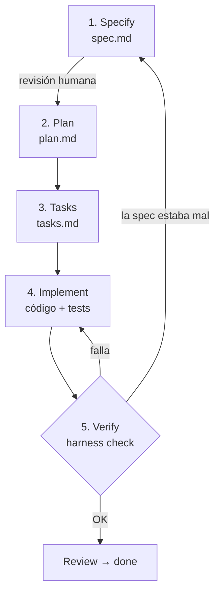

# 2. El flujo paso a paso

Cada fase produce un archivo dentro de `specs/NNN-nombre/`, y cada archivo se
revisa antes de pasar a la siguiente.



## Fase 1 — Specify (`spec.md`)

**Pregunta que responde:** ¿qué hay que construir y cómo sabemos que está bien?

Contiene: la idea original, problema, objetivos, **no-objetivos**, glosario,
reglas de negocio, contrato (API/UI/CLI) y **criterios de aceptación con ID**.

No contiene: nombres de clases, librerías, estructura de carpetas.

> Ejemplo: al escribir la spec de "recuperar contraseña por email" aparece una
> pregunta que en código habría sido una vulnerabilidad: *¿qué respondemos si el
> email no existe?* Si la respuesta cambia, un atacante puede averiguar qué emails
> están registrados. Se resuelve como regla ("la respuesta es idéntica exista o no
> el email") y como criterio con ID, **antes** de escribir código.

Plantilla: [`templates/spec.md`](../templates/spec.md) · Guía: [cómo escribir una buena spec](03-como-escribir-una-spec.md)

## Fase 2 — Plan (`plan.md`)

**Pregunta que responde:** ¿cómo lo vamos a construir?

Contiene: stack, arquitectura, decisiones de diseño con su motivo y riesgos.
Cada decisión debería poder rastrearse hasta algo de la spec. Por ejemplo: "el
reloj es inyectable **porque** AC-4 exige probar que el enlace vence a los 30 minutos".

Plantilla: [`templates/plan.md`](../templates/plan.md)

## Fase 3 — Tasks (`tasks.md`)

**Pregunta que responde:** ¿en qué orden y en qué pasos chicos?

Cada tarea dice qué AC cubre. Si un AC no aparece en ninguna tarea, falta
trabajo (el harness no deja pasar a `planned`). Si una tarea no cubre ningún
AC, sobra, o falta algo en la spec.

Plantilla: [`templates/tasks.md`](../templates/tasks.md)

## Fase 4 — Implement

Por cada tarea:

1. Escribir los tests de sus AC, con el ID en el nombre: `test('[AC-5] ...')`.
2. Correrlos y ver que fallan por la razón correcta.
3. Implementar lo mínimo para que pasen.
4. Marcar la tarea como hecha en `tasks.md`.

## Fase 5 — Verify

```bash
npm run harness -- check
```

Entre otras cosas, hace dos:

- **Trazabilidad**: [`harness/cli.js`](../harness/cli.js) lee todos los `**AC-n**` de
  las specs y todos los `[AC-n]` de los tests. Falla si un criterio de una spec en
  `review` o `done` no tiene test, o si un test referencia un criterio que no existe.
- **Tests**: corre los comandos de `harness.config.json → verify`.

Juntas garantizan: **todo lo que la spec pide está probado, y lo probado pasa.**
Lo que no garantizan es que el test pruebe *exactamente* lo que dice el criterio;
eso lo juzga el reviewer (ver [el framework](05-framework-y-harness.md)).

## ¿Y cuando cambian los requisitos?

Regla de oro: **primero la spec, después el código.**

1. Volver la spec a `draft` (`npm run harness -- move <id> draft`) y editar `spec.md`.
2. Volver a aprobarla, planificar, y `npm run harness -- trace` muestra exactamente qué criterios faltan.
3. Actualizar plan/tareas si hace falta, implementar, volver a verde.

Así la spec nunca queda desactualizada respecto del código.

## Usando SDD con un agente de IA (Cursor)

El mismo flujo funciona muy bien con un agente. En vez de pedir "hacé X", se
trabaja por fases, un prompt por fase:

1. *"Escribí la spec de esta idea con `harness new`. No escribas código. Listá las preguntas abiertas."*
2. Revisás la spec, respondés las preguntas, la aprobás.
3. *"Con la spec aprobada, escribí `plan.md`. Justificá cada decisión con un AC o regla."*
4. *"Dividí el plan en `tasks.md`; cada tarea indica los AC que cubre."*
5. *"Implementá T1. Primero los tests con `[AC-n]` en el nombre, después el código. Corré `npm run harness -- check`."*

Revisar en cada paso es más barato que revisar un PR gigante al final. El
[harness](05-framework-y-harness.md) automatiza este flujo: con un solo prompt
(*"seguí AGENTS.md y avanzá la spec 001"*) el agente sabe qué rol tomar, y el
harness le impide saltarse pasos.

Siguiente: [3. Cómo escribir una buena spec](03-como-escribir-una-spec.md)
