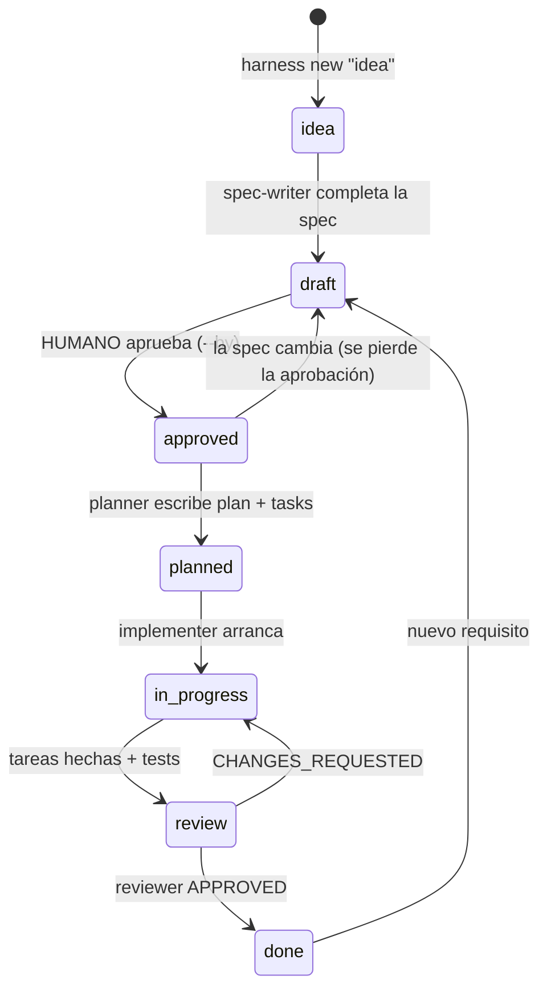
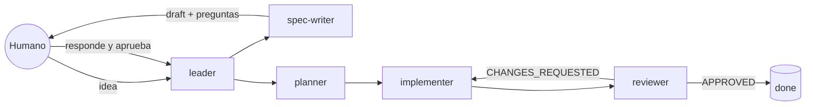

# 5. El framework: specs + harness

Las guías anteriores explican SDD a mano. Este repo además trae un **harness**:
la estructura, los scripts y las reglas que permiten que un agente de IA (o una
persona) lleve una idea hasta producción siguiendo SDD **sin saltarse pasos**,
y que cada paso quede verificado y registrado en disco.

Se inspira en el patrón de *Harness Engineering* de
[betta-tech/ejemplo-harness-subagentes](https://github.com/betta-tech/ejemplo-harness-subagentes),
con un cambio central: **la unidad de trabajo es la spec**, no una lista de features.

## Los tres pilares

| Pilar | Qué es | Dónde está |
|-------|--------|------------|
| **1. El repo es el sistema** | Todo el contexto y el estado viven en archivos versionados. | `AGENTS.md`, `specs/`, `progress/`, `docs/proyecto/`, `harness.config.json` |
| **2. Roles separados** | Quien escribe la spec no la aprueba; quien implementa no se revisa. | `harness/agents/*.md` |
| **3. Verificación ejecutable** | Las reglas las hace cumplir un programa, no la buena voluntad del agente. | `harness/cli.js`, `.cursor/hooks.json`, `CHECKPOINTS.md` |

## El ciclo de vida de una spec

Cada `spec.md` tiene un `status` en su frontmatter. Solo se cambia con
`npm run harness -- move <id> <estado>`, que evalúa la **compuerta** del estado
destino y se niega si no se cumple.



| Para llegar a… | La compuerta exige |
|----------------|--------------------|
| `approved` | Al menos un `**AC-n**`, ninguna pregunta abierta `- [ ]` y `approved_by` (un humano). |
| `planned` | Lo anterior + `plan.md` + `tasks.md` con tareas + **cada AC mencionado en alguna tarea**. |
| `in_progress` | Lo anterior + ninguna otra spec en `in_progress`. |
| `review` | Lo anterior + todas las tareas `[x]` + **cada AC con un test `[AC-n]`** + tests verdes. |
| `done` | Lo anterior + `progress/review_<id>.md` con `**Veredicto:** APPROVED`. |

No se puede saltar estados hacia adelante. Hacia atrás sí: volver a `draft` borra
`approved_by`, así que **toda modificación de la spec requiere una aprobación nueva**.

## Los roles



Cada rol está en `harness/agents/<rol>.md` con su protocolo y sus reglas duras.
Los subagentes **escriben su informe en `progress/`** y devuelven una sola línea
(`done -> progress/impl_001.md`). Así el contexto no se degrada al pasar por el
chat y queda todo auditable.

## Los comandos

```bash
npm run harness -- new "<idea>" --title "<título>"   # crea specs/NNN-slug/spec.md en estado idea
npm run harness -- status          # dónde está cada spec y qué sigue
npm run harness -- next-ac         # próximo ID de criterio libre
npm run harness -- plan 001        # crea plan.md y tasks.md desde las plantillas
npm run harness -- move 001 draft  # cambia de estado si pasa la compuerta
npm run harness -- check           # verificación completa (al empezar y al cerrar)
npm run harness -- trace           # solo trazabilidad AC ↔ tests
```

## Los hooks de Cursor

`.cursor/hooks.json` hace que dos reglas no dependan de que el agente las respete:

- **`guard-approval.sh`** (`beforeShellExecution`): si un agente ejecuta
  `harness move <id> approved`, Cursor te pide confirmación. La aprobación es tuya.
- **`check-on-stop.sh`** (`stop`): cuando el agente termina, corre `harness check`.
  Si está en rojo, le devuelve los errores para que los arregle o documente el bloqueo.

## Por qué hace falta el reviewer si todo está en verde

Cuando se probó este harness sobre un proyecto de ejemplo (un acortador de URLs
con todos sus criterios testeados y todos los tests en verde), un reviewer nuevo
en cada ronda, sin el contexto de quien implementó, lo rechazó tres veces:

| Revisión | Qué encontró |
|----------|--------------|
| 1ª | El código hacía validaciones que la spec no pedía, y un límite "en bytes" contaba caracteres. |
| 2ª | Una ruta con barra final (`/abc/`) devolvía un resultado válido en vez del 404 que exigía un criterio. |
| 3ª | Rutas como `//evil/abc` o `/x/../abc` llegaban a endpoints reales por cómo se parseaba la URL. |
| 4ª | **APPROVED**. |

Ninguno de esos defectos lo detecta la trazabilidad automática, porque había un
test por criterio y todo pasaba. Por eso existen los dos niveles: ⚙️ lo que
verifica el programa y 👀 lo que juzga el reviewer (ver `CHECKPOINTS.md`).

Hay dos lecciones:

- **Si el cambio es de comportamiento**, la spec vuelve a `draft`, se agregan los
  criterios, un humano la re-aprueba y recién después se toca el código.
- **Si es un bug contra una spec clara**, alcanza con volver a `in_progress`:
  primero el test en rojo, después el fix.

## Cómo usarlo en tu proyecto

Funciona con cualquier stack. Solo necesita Node ≥ 20 para correr el harness.

1. Copiá este repo como base de tu proyecto, o copiá estos archivos a uno existente:

   ```
   harness/                 # CLI + roles (no se tocan)
   templates/               # plantillas de spec, plan y tareas (ajustables)
   AGENTS.md  CLAUDE.md  CHECKPOINTS.md
   .cursor/hooks.json  .cursor/hooks/
   harness.config.json      # ← adaptar
   docs/proyecto/           # ← completar: arquitectura, convenciones, verificación
   progress/current.md  progress/history.md
   specs/
   ```

   Si tu proyecto ya tiene `package.json`, agregá el script `"harness": "node harness/cli.js"`.

2. Completá `docs/proyecto/*.md`.
3. Adaptá `harness.config.json`. Ejemplo para Python con pytest:

   ```json
   {
     "project": "mi-api",
     "specsDir": "specs",
     "templatesDir": "templates",
     "progressDir": "progress",
     "tests": { "dirs": ["tests"], "extensions": [".py"] },
     "verify": [
       { "name": "lint", "run": "ruff check ." },
       { "name": "tests", "run": "pytest -q" }
     ],
     "requiredFiles": ["AGENTS.md", "CHECKPOINTS.md", "docs/proyecto/arquitectura.md"]
   }
   ```

   En Python, la referencia `[AC-n]` puede ir en el docstring o en un comentario
   del test (`def test_rechaza_enlace_vencido():  # [AC-4]`). El harness busca
   `[AC-n]` en el texto del archivo, sin importar el lenguaje.

4. `npm run harness -- check` en verde y ya podés desplegar tu primera idea (ver [el recorrido](04-ejercicio.md)).
